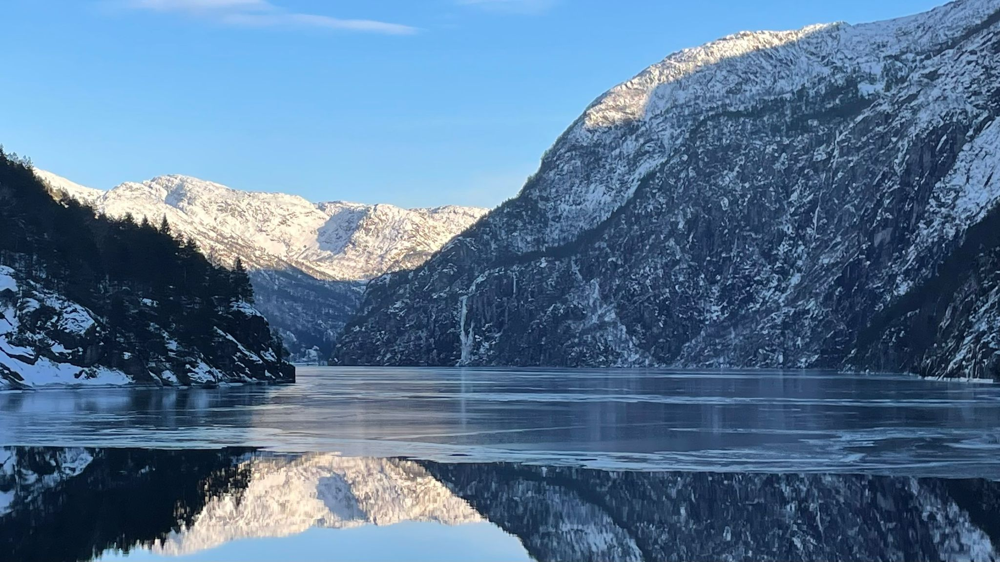
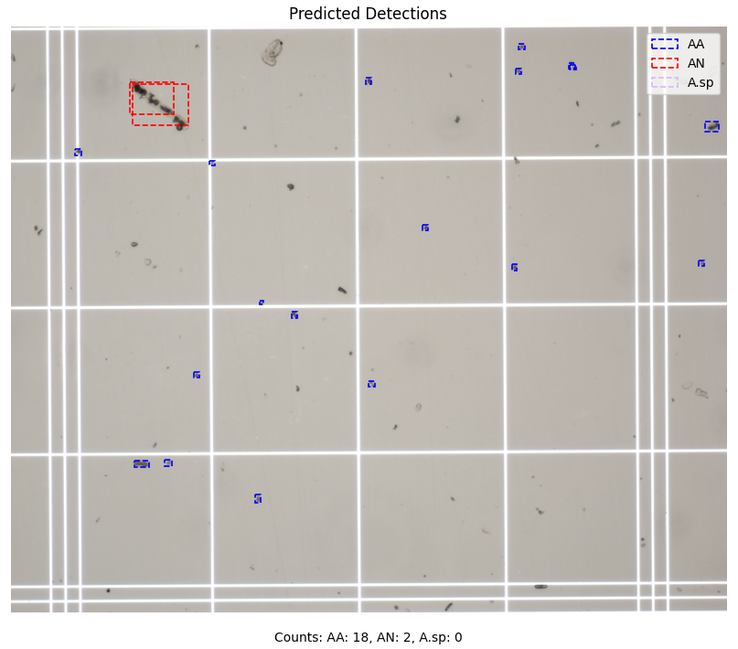
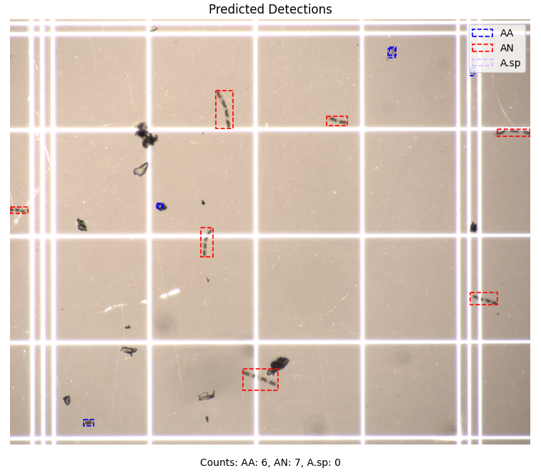

# Automated Glacial Algae Monitoring

> ⚠️ **Active Research Project**
> 
> This project is part of ongoing MRes research at the University of Bristol. The pipeline is under active development and cannot be publicly released until the research is complete. Documentation will be updated as new features and improvements are added.
> 

A comprehensive modular pipeline for automated detection and classification of glacial algae cells from light microscopy images using state-of-the-art deep learning object detection models.

## Overview

This project is part of the MRes research of the sole contributor @lzyjo at the University of Bristol, focused on developing automated methods for monitoring glacial algae communities in the cryosphere. Glacial algae play a crucial role in glacier surface albedo dynamics and biogeochemical processes, yet their monitoring remains labor-intensive and time-consuming. This pipeline automates the detection and classification of glacial algae cells, enabling large-scale quantitative analysis of microscopy images.

    
    

### Why Automated Glacial Algae Monitoring?

- **Manual counting is impractical**: Analyzing microscopy images manually is extremely time-consuming
- **Reproducibility**: Automated detection provides consistent, reproducible results
- **Scalability**: Process large datasets efficiently for temporal and spatial studies
- **Quantitative analysis**: Further applications will enable precise biomass estimation and cell morphology characterization

## Key Features

- **Data Pre-processing**: Robust pipeline for handling light microscopy images and annotation formats, including dataset structure (VOC and YOLO)
- **Data Augmentation**: Comprehensive and modular data augmentation pipeline 
- **Label Conversion**: Flexible conversion between annotation formats (VOC and YOLO) and different levels of annotation detail 
- **Model Training**: Support for state-of-the-art object detection and regression architectures
- **Performance Tracking**: Automated logging of training metrics and losses for for Excel and TensorBoard
- **Visualization**: Comprehensive and modular pipeline for performance plots and model comparison tools
- **Modular Design**: Easy to extend and customize for different datasets and models

## Supported Models

| Model Type | Model | Framework | Key Features |
|------------|-------|-----------|-------------|
| Detection | **Faster R-CNN** | PyTorch | Region Proposal Networks (RPNs) |
| Detection | **RetinaNet** | PyTorch | Focal Loss for class imbalance |
| Detection | **YOLO v10** | Ultralytics | NMS-free inference for improved speed/accuracy trade-off |
| Regression | **ResNet** | PyTorch | Deep residual networks for feature extraction |
| Regression | **DenseNet** | PyTorch | Dense connections for efficient feature propagation |

## Documentation (Installation & Usage)
Please refer to the [documentation](documentation.md) for detailed installation instructions, usage examples, and configuration options.

## Contributing

This project is part of an MRes dissertation research. While this is currently a sole-contributor project for now, suggestions and feedback are welcome.

### Development

To contribute improvements or report issues:

1. Fork the repository
2. Create a feature branch (`git checkout -b feature/improvement`)
3. Commit your changes (`git commit -am 'Add new feature'`)
4. Push to the branch (`git push origin feature/improvement`)
5. Open a Pull Request

## License

This project is available under the [MIT License](LICENSE). Future releases may use different licensing terms after the associated academic research is completed and published.

## Contact

- [Repository](https://github.com/lzyjo/Automated-Glacial-Algae-Monitoring)
- [Issues](https://github.com/lzyjo/Automated-Glacial-Algae-Monitoring/issues)
