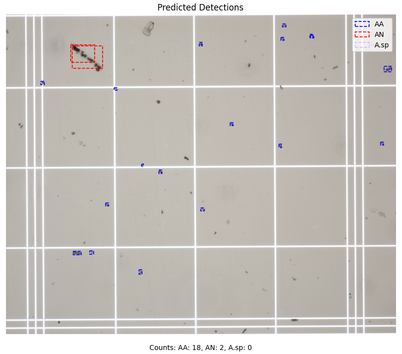
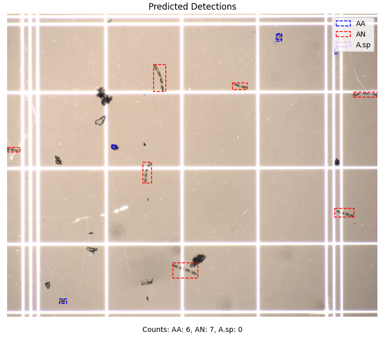

# Automated Glacial Algae Monitoring — Documentation


> ⚠️ **Active Research Project**
> 
> This project is part of ongoing MRes research at the University of Bristol. The pipeline is under active development and cannot be publicly released until the research is complete. Documentation will be updated as new features and improvements are added.
> 

[](https://www.python.org/downloads/)
[](https://pytorch.org/)
[](LICENSE)

A comprehensive modular pipeline for automated detection and classification of glacial algae cells from light microscopy images using state-of-the-art deep learning object detection models.

This document contains the detailed documentation for the Automated Glacial Algae Monitoring project. For a concise project overview, see the [README](README.md).

> **Shell note:** The commands in this document use PowerShell syntax for
> Windows. If you are using Linux or macOS, replace PowerShell line-continuation
> backticks (`` ` ``) with backslashes (`\`) and adjust file paths as needed.


## Overview

This project is part of the MRes research of the sole contributor @lzyjo at the University of Bristol, focused on developing automated methods for monitoring glacial algae communities in the cryosphere. Glacial algae play a crucial role in glacier surface albedo dynamics and biogeochemical processes, yet their monitoring remains labor-intensive and time-consuming. This pipeline automates the detection and classification of glacial algae cells, enabling large-scale quantitative analysis of microscopy images.

<p align="center">
    
    
</p>


## Supported Models

| Model Type | Model | Framework | Key Features |
|------------|-------|-----------|-------------|
| Detection | **Faster R-CNN** | PyTorch | Region Proposal Networks (RPNs) |
| Detection | **RetinaNet** | PyTorch | Focal Loss for class imbalance |
| Detection | **YOLO v10** | Ultralytics | NMS-free inference for improved speed/accuracy trade-off |
| Regression | **ResNet** | PyTorch | Deep residual networks for feature extraction |
| Regression | **DenseNet** | PyTorch | Dense connections for efficient feature propagation |


## Table of Contents

- [Installation](#installation)
- [Quick Start](#quick-start)
- [Pipeline Architecture](#pipeline-architecture)
- [Model Training](#model-training)
- [Evaluation Metrics](#evaluation-metrics)

- [Contributing](#contributing)
- [Citation](#citation)
- [License](#license)
- [Acknowledgments](#acknowledgments)

## Installation

### Prerequisites

- Python 3.8 or higher
- CUDA-capable GPU (Highly recommended for training)

### Setting up a Virtual Environment

We strongly recommend using a virtual environment to avoid dependency conflicts:

```powershell
# Create virtual environment------------
python -m venv .venv

# Activate virtual environment---------

# On Windows:
.venv\Scripts\Activate.ps1
# On Linux/Mac:
# source .venv/bin/activate
```

or otherwise in IDE such as VSCode

### Dependencies

Install the required packages using pip or uv:

```powershell
# Upgrade pip
python -m pip install --upgrade pip

# Install uv package manager (optional but faster)
pip install uv

# Install dependencies with uv
uv pip install pycocotools tensorboard tifffile torchmetrics scikit-learn scipy Pillow tqdm torchvision torch numpy DateTime matplotlib pandas argparse ultralytics pytorch-lightning

# OR with pip
pip install pycocotools tensorboard tifffile torchmetrics scikit-learn scipy Pillow tqdm torchvision torch numpy DateTime matplotlib pandas argparse ultralytics pytorch_lightning
```

### Core Dependencies

| Package | Purpose |
|---------|---------|
| torch, torchvision, pytorch-lightning | Deep learning framework |
| ultralytics | YOLO models |
| torchmetrics | Evaluation metrics |
| tensorboard | Training visualization |
| scikit-learn | ML utilities and metrics |
| matplotlib | Plotting and visualization |
| tifffile | Microscopy image handling |

## Quick Start
Before running the model, you can prepare your data using the following scripts to convert formats or labels (if specifically using a Glacial Algal Dataset, otehrwise you may adjust it for your own label conversion)
<br>


### 1. Prepare Your Data

Organize your microscopy images and annotations following the naming convention:

```
<Location>_<Month>_<Year>_<Sample>/
├── <Month>/
│   ├── <Sample_ID>/
│   │   ├── Overlays/
│   │   │   ├── Image_<XXXXXX>.tif
│   │   │   ├── Image_<XXXXXX>.tif
│   │   │   └── ...
│   │   └── annotations/
│   │       ├── annotations.xml
│   │       └── ...
│   └── ...
└── ...
```

**Example**: `Greenland_24_July_5/` or `Mort_Sept_24_mA/`


<br>

---
<br>


### 2. Use dataset formatting pipeline to convert to desired format (VOC/YOLO):

This converts multiple raw datasets into a format ready for training. You can specify the datasets to use as a comma-separated list. The script will automatically create the following folder structure:

```powershell
python dataset_formatting.py  --split True --datasets_to_use Greenland_24_July_5,Mort_Sept_24_mA 
```

Set split to True if you want to split the dataset into train/val/test, otherwise set to False. The script will automatically create the following folder structure

<br>

Alternatively, you can create an empty formatted dataset folder: 
```powershell
python create_formatted_folder.py `
    --folder_name "MyDataset" `
    --Split `
    --Augmented `
    --model_types detector cell_counter
```

If you include the `--Split` flag, the script will create train/val/test folders. 
If you include the `--Augmented` flag, the script will include an augmented in the folder name.

You can choose between model types: detector, cell_counter. If you enter both, the script will create folders for both model types. 

<br>

---
<br>


### 3. Convert Annotations


##### <u>3.1 Cleaning your dataset</u>

You can clean your dataset by removing unwanted labels, cleaning labels, and converting labels to a desired format. 

The following command removes the label "UNKNOWN" and "Question" from the annotations, cleans the remaining labels, and converts them to a format suitable for each model type. 

> [!NOTE]  
> 
> Conversions can only be carried out top-down


If model type is specified, the script will convert the labels to a format suitable for that model type. The following model types are supported:
- Cell detection: 
    Convert all labels to 'cell' except for 'UNKNOWN'
- Species classification: 
    Convert all labels to 'AA' or 'AN' except for 'UNKNOWN'
- Cell counter: 
    Convert all labels to counts ('1', '2', '3' etc) except for 'UNKNOWN'

```powershell
python clean_dataset.py --annotation_folder /path/to/annotations `
    --remove_labels UNKNOWN Question None `
    --clean_labels `
    --convert_labels `
    --model_type cell_detection
```
<b>This must be done prior to label conversion.</b>

The script will automatically create a new folder called "cleaned_annotations" in the same directory as the original annotations. The cleaned annotations will be saved in this folder.


<br>

##### <u>3.2 Converting between VOC and YOLO formats</u>


VOC to YOLO


```powershell
python voc_to_yolo.py --data_folder path/to/dataset `
    --model_type cell_detection `
    --split_dir path/to/split_dataset
```

Use `--split_dir` when the dataset is already split into train, validation,
and test sets.
<br>

YOLO to VOC

```powershell
python yolo_to_voc.py --data_yaml path/to/data.yaml `
    --output_dir path/to/voc
``` 

---


### 4. Data Augmentation (Optional)

You can choose between different augmentation techniques to increase the size of your dataset and improve model generalization. The following command applies horizontal flipping to the images in the specified raw directory and saves the augmented images to the specified augmented directory. 
You can also enable visual checks to verify the augmentations.

```powershell
python augmentation.py --model_type detector `
    --augmentations horizontalflip,verticalflip,rotation,colorjitter `
    --raw_dir path/to/raw/dataset `
    --augmented_dir path/to/augmented/dataset `
    --visual_check True
```

In order to apply multiple augmentations, you can specify them as a comma-separated list:

You can choose from the following augmentations: 
- colorjitter
- horizontalflip
- verticalflip
- randomrotation
- randomresizecrop


---

### 5. Train a Model

```powershell
python train.py --model_name faster_rcnn `
    --model_type classifier `
    --data_folder path/to/dataset `
    --data_format VOC `
    --loss_function BCE `
    --early_stopping True
```

---

### 6. Evaluate Performance

```powershell
python eval.py `
    --checkpoint checkpoint_file.pth `
    --model_name model_name `
    --data_folder path/to/images `
    --num_classes number_of_classes `
    --results_dir path/to/results

# if using a pre-trained model, add --pretrained
# model_name can be resnet18 or densenet121
# if you want to define an optimizer, add --optimizer optimizer_name; otherwise, the default is sgd
```

Otherwise, you can load and evaluate your own trained models using the same command above, but with your own checkpoint file.

Note that your data_folder format must match VOC format (test/train/val)

---

### 7. Inference: Using pre-trained detectors and counters
You can use pre-trained detectors and counters by downloading and loading the revelant checkpoints below:

Detectors:
- [Faster R-CNN checkpoint](https://drive.google.com/file/d/1gf3AM6cUvYnvMyLhbLwZvFsmediMmRRA/view?usp=sharing)
- [RetinaNet checkpoint](https://drive.google.com/file/d/1oZJxOv-OczhhZnJUG3PxGoj3peacOrUf/view?usp=sharing)
- [YOLOv10 checkpoint](https://drive.google.com/file/d/1gf3AM6cUvYnvMyLhbLwZvFsmediMmRRA/view?usp=sharing)

Counters
- [DenseNet-121 checkpoint](https://drive.google.com/file/d/1wqkOqYS4tyQweHj-2UP6rjmAO8b4sNbt/view?usp=sharing)
- [ResNet-18 checkpoint](https://drive.google.com/file/d/1Z1DigzFP1kdw03jjKb3kAUQTOpaHfpD3/view?usp=sharing)

<br>

The following model (names for input into the script) are supported for inference:
- fasterrcnn_resnet50_fpn
- retinanet_resnet50_fpn
- resnet18
- densenet121

YOLO checkpoints can only be used directly with the `ultralytics` library.

<br>

```powershell
python detect.py `
    --checkpoint_path checkpoint_file.pth `
    --img_path image_file.tif `
    --ground_truth False `
    --model_type detector ` #detector or counter
    --model_name resnet18 `
    --pretrained `
    --regression `
    --overlay
```

Use `True` or `path/to/ground_truth` for `--ground_truth`, and use `counter`
for `--model_type` when running a counting model. Add `--regression` for
counter models and `--overlay` to overlay results on the original image.

---

## Pipeline Architecture

The pipeline consists of the following modular components:


```
┌──────────────────────┐
│  Raw Microscopy      │
│  Img + Annotations   │
└──────────┬───────────┘
           │
           ▼
┌──────────────────────┐
│ Data Preprocessing   │
│ - Label conversion   │
│ - Format conversion  │
└──────────┬───────────┘
           │
           ▼
┌──────────────────────┐
│ Data Augmentation    │
└──────────┬───────────┘
           │
           ▼
┌──────────────────────┐
│  Model Training      │
│ - Multiple models    │
│ - Multiple types     │
│ - Multiple losses    │
└──────────┬───────────┘
           │
           ▼
┌──────────────────────┐
│ Metrics & Logging    │
│ - Loss tracking      │
│ - TensorBoard        │
│ - Performance plots  │
└──────────┬───────────┘
           │
           ▼
┌──────────────────────┐
│ Model Evaluation     │
│ & Comparison         │
└──────────────────────┘
```

---

### Annotation Format

The pipeline accepts annotations using:
- **ImageJ** (.xml files)
- **MIA** (Modular Image Analysis)
- **FIJI** (Fiji Is Just ImageJ)

which gives you VOC formatted .xmls 


---

### Concepts

Links to publications will be added once the research is published.

---


### Model Training, Evaluation, and Inference

<br>

###### Training Configuration

Customize training via command-line arguments and hyperparameter/configuration files:

```powershell
python train.py `
    --model_name faster_rcnn `
    --model_type classifier `
    --data_folder path/to/dataset `
    --data_format VOC `
    --loss_function BCE `
    --early_stopping True
```

You can choose between using different loss functions for training, including:

- **PyTorch Built-in Losses**
- **Cross-Entropy (CE)**
- **Binary Cross-Entropy (BCE)**
- **Smooth L1 Loss**
- **Mean Squared Error (MSE)**
- **L1 Loss**
- **Hamming Loss**

<br>

###### Monitoring Training

View training progress in real time with TensorBoard. Training results can also be reviewed in the generated Excel or CSV files.

<br>

###### Evaluation Metrics

Model performance is evaluated using multiple metrics:

<u>Object Detection Metrics</u>:

- **mAP** (mean Average Precision)
- **mAP@0.5** (AP at IoU threshold 0.5)
- **mAP@0.75** (AP at IoU threshold 0.75)
- **IoU** (Intersection over Union)
- **Precision**
- **Recall**
- **Accuracy**
- **F1 Score**
- **Confusion Matrix**
- **Precision-Recall Curve**

<u>Regression Metrics</u>:
- **Mean Squared Error (MSE)**
- **Mean Absolute Error (MAE)**
- **R-squared (R²)**
- **Root Mean Squared Error (RMSE)**
- **Custom metrics using rounded predictions** (e.g., for cell counting)

<br>

###### Performance Visualization

The pipeline generates the following visualizations:

- Training/validation loss curves
- Precision-recall curves
- Accuracy over epochs
- Confusion matrices
- Detection visualizations

---

## Contributing

This project is part of an MRes dissertation research. While this is currently a sole-contributor project for now, suggestions and feedback are welcome.


## License

This project is available under the [MIT License](LICENSE). Future releases may use different licensing terms after the associated academic research is completed and published.

## Acknowledgments

- **University of Bristol** - MRes Program support, particularly my supervisors Dr Levi Wolf and Chris Williamsons, and [MicroLab](https://microlabbristol.org/)
- **PyTorch** and **Ultralytics** teams - Deep learning frameworks
- **Glaciology research community** - Domain expertise and datasets
- All open-source contributors whose libraries made this work possible

## Contact

For questions or collaborations:
- **Repository**: [github.com/lzyjo/Automated-Glacial-Algae-Monitoring](https://github.com/lzyjo/Automated-Glacial-Algae-Monitoring)
- **Issues**: [GitHub Issues](https://github.com/lzyjo/Automated-Glacial-Algae-Monitoring/issues)

---
